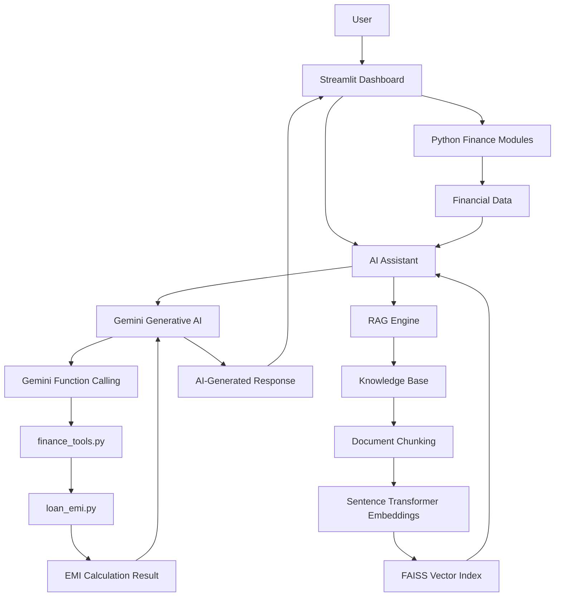

# FinWise AI — System Architecture

## 1. Project Overview

FinWise AI is a Streamlit-based personal finance application. It combines Python finance utilities with Gemini-powered generative AI and a retrieval-augmented generation (RAG) pipeline.

## 2. Architecture Diagram

## 3. Main Components

### User Interface
- **Streamlit dashboard:** Provides the user-facing interface.
- **AI Assistant:** Accepts finance-related questions and displays generated responses.

### Application and Finance Logic
- Python modules perform calculations and finance-related operations.
- The application uses financial data such as transactions and financial goals.

### Generative AI
- Gemini generates natural-language answers, explanations, insights, and recommendations.

### Retrieval-Augmented Generation (RAG)
1. Text files are loaded from `data/knowledge_base/`.
2. Documents are split into overlapping chunks.
3. Sentence Transformers creates vector embeddings.
4. FAISS indexes the embeddings.
5. Relevant chunks are retrieved for a user's question.
6. Retrieved context is included in the prompt sent to Gemini.

### Tool Calling
1. Gemini can request the `calculate_loan_emi` function.
2. `finance_tools.py` validates the requested tool name and dispatches the call.
3. `loan_emi.py` calculates the EMI, total payment, and total interest.
4. The calculation result is sent back to Gemini.
5. Gemini generates a natural-language response.

## 4. Important Implementation Note

The RAG retrieval pipeline has been tested, and the standalone Gemini function-calling workflow has succeeded previously. The final function-calling integration test inside the Streamlit application is still pending because Gemini has returned intermittent `503 UNAVAILABLE` errors. Do not describe that final integration test as passed until it succeeds.

## 5. Key Technologies

- Python
- Streamlit
- Google Gemini API (`google-genai`)
- Sentence Transformers (`all-MiniLM-L6-v2`)
- FAISS
- NumPy
- Pandas
- Plotly
